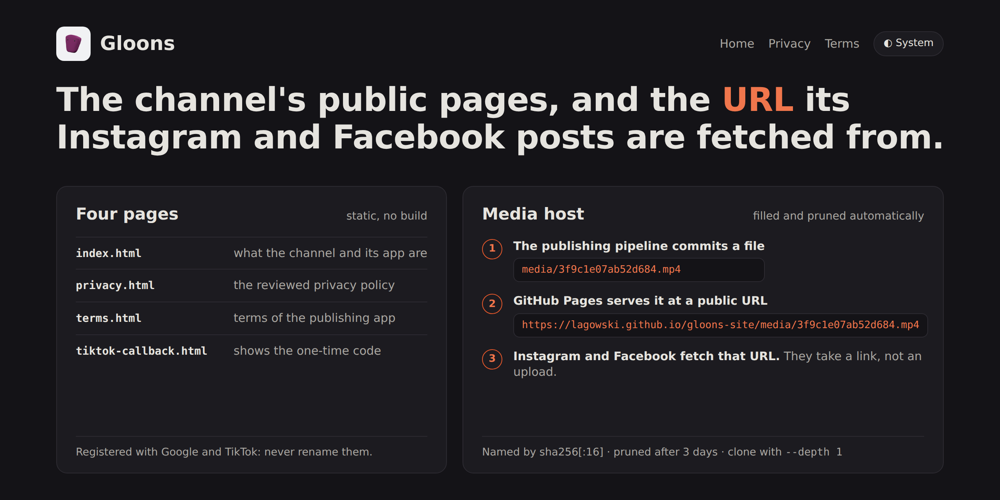
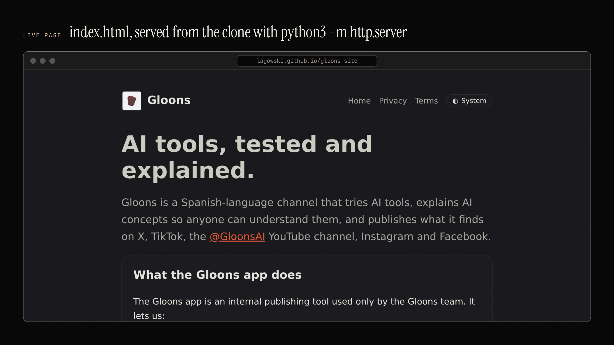
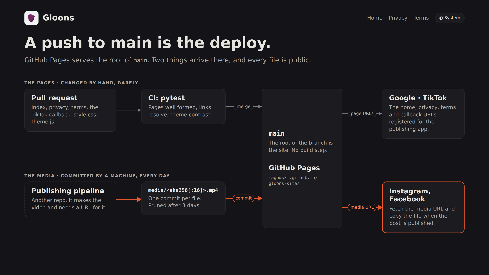

<p align="center"><a href="https://lagowski.github.io/gloons-site/"><picture>
  <source media="(prefers-color-scheme: light)" srcset="docs/images/banner-light.png">
  
</picture></a></p>

<p align="center"><b>The Gloons channel's public pages and the media host for its Instagram and Facebook posts.</b><br>
<a href="#quick-start">Install</a> · <a href="#how-it-works">How it works</a></p>

<p align="center">   </p>

The public pages of the Gloons channel (home, privacy policy, terms, the TikTok authorization callback)
and the media host for its Instagram and Facebook posts. Served by GitHub Pages at
<https://lagowski.github.io/gloons-site/>.

<p align="center"></p>
<p align="center"><sub>The home page, served from a clone with python3 -m http.server (the same files GitHub Pages serves).</sub></p>

## How it works

<p align="center"></p>

## Quick start

```
git clone --depth 1 https://github.com/lagowski/gloons-site
cd gloons-site
python3 -m http.server 8000      # then open http://localhost:8000/
```

Plain static files: no build step, no dependencies. Use `--depth 1`: the history holds every media
file ever hosted, so a full clone is about 1 GB.

## Test

```
python -m pip install pytest
python -m pytest tests/ -q
```

`tests/test_site.py` checks that every page is well formed and that its local links resolve;
`tests/test_theme.py` checks the light/dark theme (contrast, colour tokens, motion, the toggle).
CI (`.github/workflows/ci.yml`) runs the same command on pull requests.

## Deploy

GitHub Pages serves the `main` branch from the root, so a merge to `main` publishes the site. Every
file in the root is public.

## Layout

- `index.html`, `privacy.html`, `terms.html`, `tiktok-callback.html`: the pages; `style.css` and
  `theme.js` are shared.
- `media/`: videos and images hosted for Instagram and Facebook. It is filled and pruned
  automatically; don't change it by hand.

Notes for Claude Code sessions are in [CLAUDE.md](CLAUDE.md).
