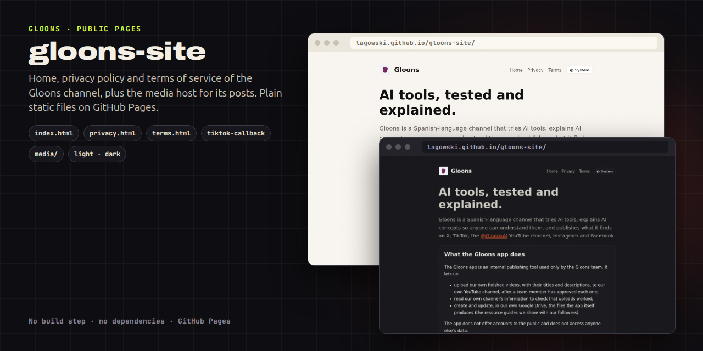

# gloons-site

The public pages of the Gloons channel (home, privacy policy, terms, the TikTok authorization callback)
and the media host for its Instagram and Facebook posts. Served by GitHub Pages at
<https://lagowski.github.io/gloons-site/>.



## Quick start

```
git clone --depth 1 https://github.com/lagowski/gloons-site
cd gloons-site
python3 -m http.server 8000      # then open http://localhost:8000/
```

Plain static files: no build step, no dependencies. Use `--depth 1`: the history holds every media
file ever hosted, so a full clone is about 1 GB.

## Test

```
python -m pip install pytest
python -m pytest tests/ -q
```

`tests/test_site.py` checks that every page is well formed and that its local links resolve;
`tests/test_theme.py` checks the light/dark theme (contrast, colour tokens, motion, the toggle).
CI (`.github/workflows/ci.yml`) runs the same command on pull requests.

## Deploy

GitHub Pages serves the `main` branch from the root, so a merge to `main` publishes the site. Every
file in the root is public.

## Layout

- `index.html`, `privacy.html`, `terms.html`, `tiktok-callback.html`: the pages; `style.css` and
  `theme.js` are shared.
- `media/`: videos and images hosted for Instagram and Facebook. It is filled and pruned
  automatically; don't change it by hand.

Notes for Claude Code sessions are in [CLAUDE.md](CLAUDE.md).
